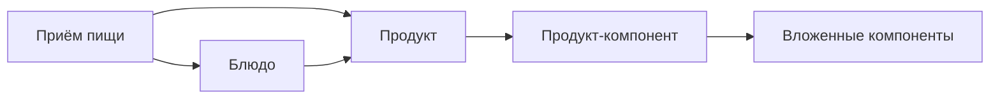

# Спецификация Nutrition Assistant: сценарии и правила данных

Версия: 1. Дата: 17 ноября 2026 года. Результат этапа 1 [плана развития](development-roadmap.ru.md).

Документ фиксирует целевое поведение последующих этапов. Он не означает, что новые поля и функции уже реализованы. Доступное поведение описано в [русском](user-manual.ru.md) и [английском](user-manual.en.md) руководствах.

## 1. Границы и принятые предположения

- Основной сценарий — личный дневник взрослого пользователя на одном Android-устройстве, без учётной записи, сервера и обязательного интернета. Поддержка Android 8.0+ и русский интерфейс сохраняются.
- Пользователь отмечает питание, лекарства и состояние, проверяет состав и повторяющиеся связи. Приложение не устанавливает диагноз, не назначает лечение и не подтверждает непереносимость автоматически.
- Первый выпуск включает этапы 1–7, следующий — аналитику и внешнюю выгрузку. Ссылки на магазины и модель на телефоне проходят отдельную проверку целесообразности.
- Рабочее предположение для правового исследования — распространение в РФ и личное использование. Публичный/коммерческий выпуск и другие страны пока не подтверждены; перед этапом 10 применимость предположения проверяется заново. Оно не служит юридическим разрешением.
- В рамках этапа 1 проектные решения ниже принимаются как исходные для реализации. Возвращаться к пользователю требуется при существенной неразрешимой неоднозначности, а не для каждого обычного решения.
- Существующие записи и работающий выбор блюд вместе с продуктами сохраняются. Новая спецификация применяется через последовательные миграции и не требует очистки дневника.

## 2. Понятия и связи

| Понятие | Определение | Примеры |
| --- | --- | --- |
| Базовый продукт | Общая пищевая позиция без привязки к продавцу; может быть самостоятельным компонентом | Рис, гречка, яйцо, говядина, чеснок |
| Вариант продукта | Конкретный состав или товар; отличается UUID, маркой/уточнением, составом и источником | Фарш марки X с чесноком; хлеб конкретного производителя |
| Состав продукта | Ссылки на продукты-компоненты; каждый компонент может иметь свой состав | Покупные пельмени → начинка и тесто → мясо, мука, вода |
| Блюдо | Домашний рецепт либо ресторанная позиция из справочника, собранная из продуктов | Котлета из покупного фарша; картофельное пюре |
| Приём пищи | Одно фактическое событие с одной или несколькими позициями «блюдо или продукт» | Пельмени; котлета + пюре + огурец |
| Приём лекарства | Одно событие с одним или несколькими лекарствами и индивидуальными дозировками | Два препарата в одном приёме |
| Запись состояния | Наблюдение за момент времени, день или завершившуюся ночь | Стул в 09:20; стресс за день; сон за ночь |

Самостоятельный продукт не требует искусственного блюда с тем же названием. Домашние пельмени можно сохранить блюдом, покупные — продуктом с составом. Одни и те же понятия могут иметь разные варианты; название не является идентификатором.

## 3. Идентичность, жизненный цикл и поиск

1. Переносимые объекты имеют стабильный UUID. Локальный числовой ключ Room не является идентификатором обмена. Изменение записи не меняет её UUID.
2. У продукта и блюда есть версия содержимого для снимка истории. Правка названия, категории или состава увеличивает версию; отдельный товар или рецепт-вариант получает новый UUID.
3. Название обязательно, после удаления крайних пробелов содержит 1–1000 символов. Комментарий необязателен, до 1000 символов. Пустой комментарий сохраняется как отсутствие значения. Старые данные не обрезаются при миграции.
4. Поиск использует нормализацию регистра, повторных пробелов и е/ё. Исходное написание сохраняется. Поиск работает по названию и уточнению; поиск по компоненту включается отдельно и показывает путь состава.
5. Совпавшее нормализованное название предлагает проверить существующие варианты, но не объединяет разные товары. Внутренний уникальный ключ текущего каталога пересматривается на этапе 4. В импорте этапа 2 до его пересмотра неоднозначное совпадение блокируется для явного сопоставления без молчаливой потери данных.
6. Создание варианта из базового продукта копирует редактируемые сведения, сохраняя связь с базовым продуктом при наличии. Аналитика не наследует переносимость базового продукта на все варианты.
7. «Архивировать» скрывает позицию из обычного выбора новых записей. История и существующие рецепты сохраняют ссылки. В редакторе старого рецепта архивная позиция видна и может быть оставлена или удалена из состава.
8. Возврат из архива — явное действие. Создание одноимённой новой позиции предлагает варианты, а не автоматически подменяет или восстанавливает старую.
9. Созданный из редактора продукт остаётся в каталоге при отмене блюда/события; интерфейс сообщает об этом. Отмена самого редактора продукта его не создаёт.
10. Для лекарства обязательным остаётся название. Дозировка принадлежит факту приёма, а не универсальной рекомендации из справочника. Лекарство можно редактировать и архивировать по тем же правилам сохранения истории.

## 4. Состав и категории

У продукта одна основная категория из версионируемого справочника. Категория обязательна для новых записей; «Прочее» допустимо, категория старой записи может остаться неизвестной до редактирования. Категория помогает поиску и не определяет переносимость.

Начальный набор категорий: крупы и зерновые; мука и хлеб; овощи и зелень; фрукты и ягоды; мясо и птица; фарш и полуфабрикаты; рыба и морепродукты; яйца; молочные продукты и альтернативы; бобовые; орехи и семена; масла; специи и соусы; напитки; прочее. Коды не зависят от отображаемых названий.

Состояние состава хранится явно:

| Код | Смысл | Правило |
| --- | --- | --- |
| `unknown` | Состав не установлен | Пустой список не означает отсутствие добавок |
| `partial` | Известна часть состава | Известные компоненты сохраняются, отсутствующие не считаются исключёнными |
| `confirmed` | Состав указан полностью в рамках выбранного источника | Обязательны источник и дата проверки; это не гарантия лабораторной точности |

Простой продукт, например огурец, может быть самостоятельным конечным компонентом с подтверждённым однокомпонентным характером без ссылки на самого себя. Для составного продукта подтверждение включает его непосредственные компоненты. Подтверждённый внешний уровень с неизвестным вложенным компонентом не делает всё дерево полностью известным: при развёртывании сохраняется неизвестность этого компонента.

Правила состава:

- Источник — упаковка, рецепт пользователя, сайт с URL либо иной подписанный источник; дата проверки обязательна для подтверждения. Встроенный пример маркируется как пример, а не сведения о любом одноимённом товаре.
- Прямое и косвенное включение продукта в самого себя запрещено. Предварительные ограничения: до 16 уровней вложенности и до 10 000 узлов после развёртывания одного приёма пищи; превышение вызывает понятную ошибку без частичного сохранения. Эти пределы проверяются на этапе 4.
- Состав блюда включает один или несколько продуктов; разрешён продукт с неизвестным составом. Неизвестный ресторанный состав можно сохранить явно, не добавляя выдуманный ингредиент для обхода валидации.
- Вложенность между блюдами пока не вводится: повторно используемый полуфабрикат оформляется продуктом.
- Количество и единица необязательны. При заполнении количество положительно, единица — граммы, миллилитры или штуки; единица без количества и количество без единицы не принимаются. Неизвестность хранится отдельно от нуля.
- Массу, объём и штуки нельзя автоматически складывать или переводить без известных коэффициентов. При неполной массе порции итоговое количество ингредиента не угадывается.
- Для отслеживаемых веществ допускается отдельная метка с источником. Наличие лактозы не выводится автоматически из слов «хлеб» или «молочный». Лактоза и молочный белок не объединяются в один фактор.
- Стартовый каталог этапа 5 содержит примерно 80–120 базовых продуктов и шаблоны с явными источниками. Его обновление не перезаписывает пользовательские правки или архивирование.

## 5. Обязательные поля событий и история

| Запись | Обязательные пользовательские поля | Дополнительные поля |
| --- | --- | --- |
| Продукт | Название, категория, вид «базовый/вариант», состояние состава | Марка/уточнение, состав, количество компонентов, источник, комментарий |
| Блюдо | Название, домашнее/ресторанное, состояние состава | Продукты, количества, источник, комментарий; при известном составе нужен хотя бы один продукт |
| Приём пищи | Дата, тип «завтрак/обед/ужин/перекус», минимум одна позиция каталога | Фактическое время, порция каждой позиции, комментарий события и позиции |
| Приём лекарства | Дата, минимум одно лекарство каталога | Фактическое время, отдельная дозировка каждой позиции, комментарии |
| Стул | Дата, тип 1–7 | Фактическое время, срочность, боль, комментарий |
| Оценка дня/момента | Дата или период и значение выбранного показателя | Время для событий, комментарий |
| Сон | Дата пробуждения, оценка качества при создании новой оценки | Даты и время отбоя/подъёма, пробуждения, комментарий |

Системные UUID, даты создания/изменения и версии назначаются приложением. Каждое наблюдение состояния заполняется независимо: сохранение дня не требует всех показателей. Вода сохраняет существующий ввод числа стаканов, целое значение от нуля; отсутствие записи отличается от явно введённого нуля.

Для лекарства поддерживается старое свободное описание дозировки без потери значения. Структурированные количество/единица добавляются как дополнительные поля, когда пользователь их ввёл; старый текст не преобразуется в число догадкой.

Снимок позиции приёма пищи содержит UUID и версию источника, исходные название и тип, порцию, дерево компонентов, пути, сведения об источниках, неопределённость и комментарии, относящиеся к событию. Снимок лекарства хранит название и дозировку на момент приёма.

- Переименование, изменение состава, категории и архивирование каталога не переписывают снимки.
- При обычном редактировании события существующие позиции сохраняют снимок. Для применения текущего состава нужно явное действие «Обновить состав этой позиции» с предварительным просмотром изменений.
- Исправление времени, порции, комментария или состава прошлого события сохраняется по явному нажатию «Сохранить». При отмене исходная запись остаётся.
- Удаление события удаляет его позиции, но не справочники. Оно требует подтверждения, сводка и аналитика пересчитываются.
- Если тот же компонент встречается несколькими путями, сохраняются все пути происхождения. Для счётчика наличия фактора за день он учитывается один раз; количественная агрегация требует совместимых единиц.

## 6. Время и полнота дневника

- `createdAt` и `updatedAt` описывают работу с записью. Фактическое время события — отдельное поле.
- Новая запись показывает текущую/выбранную дату; время предлагается явно и может остаться неизвестным. Пользователь видит, какое значение сохраняет.
- Точность — `date_only` или `date_time`; у точного времени сохраняется смещение UTC, а идентификатор часового пояса — при доступности. При неоднозначном времени перехода часового пояса смещение уточняется; оно не придумывается для старых данных.
- При переносе устройства в другой часовой пояс исходная локальная дата записи сохраняется в календаре. Для сравнения точных событий используется их время со смещением.
- События одного типа не уникальны по дате. Повторный завтрак создаётся отдельно; «Добавить» и «Изменить» — разные действия после этапа 4.
- Сон по умолчанию относится к ночи перед выбранной датой пробуждения. Если заданы обе границы, они включают даты, окончание позже начала; интервал в постели подписывается именно так. Качество можно оценить и без точных времён.
- Для питания и симптомов за день есть независимое подтверждение `complete`/`incomplete`; начальное состояние — `incomplete`. Полнота не выводится из количества записей.
- Подтверждённый день симптомов может содержать оценённые эпизоды либо явную отметку «Стул был, жидкого не было»/«Стул не был». Сам факт подтверждения полноты без указания результата не создаёт нормальный стул.
- Изменение, добавление или удаление записи сбрасывает соответствующее подтверждение полноты и предлагает проверить день заново. Остальные показатели не меняются.
- Неизвестный состав не исключает заполнение питания, но не позволяет считать конкретный компонент отсутствующим. Аналитика отдельно оценивает пригодность данных для каждого фактора.
- Дневная оценка стресса или болезни без времени обозначает весь день. Её нельзя автоматически считать событием до утреннего эпизода.

## 7. Шкалы и комментарии

Собственные шкалы ниже имеют версию 1; это последовательная самооценка пользователя. Готовые опросники и основания их отдельного рассмотрения приведены в [плане развития](development-roadmap.ru.md). Баллы разных показателей не складываются в «общий индекс здоровья».

| Показатель | Значения | Период |
| --- | --- | --- |
| Стул | 1–7 по существующей Бристольской шкале; 0 только для старых неоценённых записей | Каждое событие |
| Сон | 1 — очень плохое; 2 — плохое; 3 — среднее; 4 — хорошее; 5 — очень хорошее | Завершившаяся ночь |
| Стресс | 0 — отсутствовал; 1 — слабый; 2 — умеренный; 3 — сильный; 4 — очень сильный | День; дополнительно отдельные события |
| Активность | `none` — не было; `light` — лёгкая; `moderate` — умеренная; `vigorous` — высокая | День либо отдельная нагрузка с длительностью |
| Самочувствие | 1 — очень плохое; 2 — плохое; 3 — среднее; 4 — хорошее; 5 — очень хорошее | День либо момент |
| Признаки болезни | `none` — нет; `present` — есть; `unknown` — не знаю | День либо момент |
| Влияние болезни | `mild` — лёгкое; `moderate` — умеренное; `severe` — тяжёлое | Только при наличии признаков; можно не оценивать |

У всех показателей есть отдельное отсутствие записи. «Не знаю» о болезни — сохранённый ответ, а не пропуск. При «нет признаков» степень влияния не сохраняется. Категории симптомов: пищеварительные, респираторные, повышение температуры, другие; допускается несколько и необязательный комментарий. Диагноз для сохранения не требуется.

Для активности при `none` длительность и вид нагрузки отсутствуют. При наличии продолжительность необязательна, но при вводе положительна. Несколько нагрузок показываются отдельно; сводка явно подписывает максимальную отмеченную интенсивность и отдельно сумму известных минут, не включая пропуски как нули.

Дополнительные поля события стула: срочность 0 — нет / 1 — умеренная / 2 — сильная; боль 0 — нет / 1 — слабая / 2 — умеренная / 3 — сильная. Они необязательны и описывают наблюдение пользователя.

Для нескольких моментных оценок за день показывать исходные события. Дневная оценка хранится отдельно; автоматически подменять её средним по событиям нельзя. У каждого выбора категории или шкалы доступен необязательный комментарий: в карточке продукта/блюда/лекарства, событии, позиции приёма и оценке состояния. Выбор значения сам по себе достаточен для сохранения.

## 8. Короткие формы и оформление

- Сохранить зелёную палитру, светлую/тёмную тему по Android и общую типографику существующей темы Compose. На этапе 3 закрепить единые токены шрифта, отступов, форм, ошибок и кнопок.
- Шкала: название → подписанные варианты → раскрываемый «Комментарий» → «Сохранить»/«Отмена». Нулевое или первое значение не выбирается скрыто по умолчанию.
- Приём пищи: дата/время и тип → выбранные позиции → поиск с вкладками «Блюда/Продукты» и фильтрами → необязательные порции и комментарии → сохранение.
- Редактор каталога: название и категория/тип → состояние и компоненты состава → источник → необязательный комментарий. Длинный состав получает отдельный прокручиваемый экран или панель.
- В разделе «Данные» разместить backup и внешнюю выгрузку с разными названиями и описанием назначения. Стартовая структура вкладок сохраняется; точное расположение раздела определяется на этапе 2 и фиксируется в обоих руководствах.
- Все окна приложения, включая дату/время, подтверждение удаления, вложенное создание, ошибку импорта и конфликт, используют общие компоненты. Системный выбор файла и разрешения остаются в стиле Android.
- Сохранение блокирует повторное нажатие; ошибка оставляет введённые значения и показывает, что исправить. Закрытие изменённой формы предлагает сохранить/отбросить изменения.
- Проверять экран шириной 360 dp, системный шрифт 100% и 200%, клавиатуру, светлую/тёмную тему, озвучивание и сохранение черновика при пересоздании экрана. Цвет сопровождается текстом/значком, интерактивная область — минимум 48 dp.

## 9. Backup, миграции, календарь и аналитика

### Резервные копии и совместимость

- На этапе 2 добавить минимальную миграцию UUID и backup текущей схемы. Вложенный состав не является условием начала backup; при его появлении версия формата увеличивается в том же этапе реализации.
- Backup включает весь пользовательский дневник, каталог с архивом, исторические снимки и настройки. Операционные журналы уведомлений не восстанавливаются; расписание пересоздаётся из настроек.
- Версия формата JSON независима от Room. Начальные лимиты: 16 МиБ UTF-8 и 100 000 объектов; неизвестные версии/поля, некорректные значения, ссылки и UUID дают ошибку до записи.
- Пользователь видит предпросмотр и подтверждает применение. По умолчанию импорт объединяет данные; совпавшие UUID с одинаковым содержимым не добавляются, различия не перезаписывают локальные данные без явного решения.
- Для настроек с конфликтом по умолчанию сохраняется локальное значение. Восстановление выбранного набора настроек подтверждается отдельно в предпросмотре.
- На чистой установке встроенные записи, созданные до импорта, требуют явного сопоставления со справочником копии при конфликте; исходные UUID и снимки истории сохраняются. Пользовательские варианты не сливаются по имени. Протокол сопоставления уточняется в формате этапа 2.
- Отмена и ошибка оставляют базу прежней. Применение — одна транзакция; после изменения базы за время предпросмотра нужен повторный расчёт.
- Миграции 1/2/3 в последующие версии сохраняют данные, старые снимки и свободный текст. Отсутствующие категории, состав, время и баллы не угадываются. Старый текст сна/самочувствия становится комментарием без автоматического балла.
- Резервная копия — незашифрованный файл с чувствительными данными. Выбор места и передача запускаются пользователем; внешняя аналитическая выгрузка ограничивается выбранным периодом и полями.

### Календарь и наблюдения

- Красная отметка означает наличие хотя бы одного сохранённого типа 6/7. Подпись — «Жидкий стул, тип 6–7»; тип 5 сам по себе её не включает.
- Счётчик эпизодов, число проблемных дней и полнота дневника различаются. Удаление последнего типа 6/7 снимает отметку; пустой день остаётся неизвестным.
- Аналитика показывает наблюдаемые связи, исходные записи, размеры групп, метод и ограничения. Порог уверенности и статистические методы определяются и проверяются на этапе 8 до показа рейтинга.
- Окна 0–6, 6–24 и 24–48 часов — исследовательские настройки. В них попадают только события с пригодным фактическим временем; записи только с датой анализируются отдельно.
- Факторы включают ингредиенты по историческим путям, продукты/варианты, блюда, лекарства и дозировки, сон, стресс, активность, самочувствие и болезнь. Для неизвестных значений и неразделимых совместных факторов выдаётся соответствующее ограничение.
- Лекарство, принятое после симптома, не становится его предшествующей причиной. Комментарии до появления модели показываются как текст рядом с данными.
- Внешняя выгрузка содержит словарь шкал, единицы, точность времени, неизвестность и ссылки на события. Комментарии можно исключить; текст рассматривается как данные, а не инструкции модели.

## 10. Синтетические примеры и сценарии приёмки

Все составы в этом разделе вымышлены для проверки алгоритмов и не описывают реальные товары. Встроенный каталог не должен выдавать их за универсальный состав продуктов.

Тестовый набор:

| Ключ | Позиция | Заданный состав |
| --- | --- | --- |
| P01 | Говядина | Конечный компонент |
| P02 | Чеснок | Конечный компонент |
| P03 | Фарш X | Подтверждённый: P01 + P02; источник — синтетическая упаковка |
| P04 | Фарш Y | Подтверждённый: только P01; самостоятельный вариант |
| P05 | Картофель | Конечный компонент |
| P06 | Вода | Конечный компонент |
| P07 | Огурец | Конечный компонент |
| P08 | Мука | Конечный компонент |
| P09 | Пельмени X | Подтверждённый: P03 + P08 + P06 |
| P10 | Хлеб без уточнения | Состав неизвестен |
| D01 | Котлета говяжья | Домашнее блюдо: P03 |
| D02 | Пюре | Домашнее блюдо: P05 + P06 |
| D03 | Котлета без чеснока | Домашнее блюдо: P04 |

Для каждого подтверждённого состава источник и дата заданы в тестовой подготовке; количества специально не указаны. Ключи P/D обозначают фикстуры, в приложении им соответствуют стабильные UUID.

| ID | Действие/условие | Ожидаемый результат | Этап проверки |
| --- | --- | --- | --- |
| S01 | Создать базовый продукт «Рис», затем найти « рис » | Найдена та же позиция; исходное название сохранено; категория обязательна | 4–5 |
| S02 | Сохранить P03 и P04 с одинаковым отображаемым названием, разными уточнениями | Два UUID и различимые варианты; автоматического объединения нет | 4–5 |
| S03 | Сохранить один приём с P09 | Одна позиция-продукт, одно событие; раскрываются P03/P08/P06 и далее P01/P02 | 4–5 |
| S04 | Сохранить приём только из P07 и P10 | Две позиции-продукта; неизвестность P10 видна; не требуется создавать блюдо | 4–5 |
| S05 | Сохранить приём из D01 и D02 | Две позиции-блюда, одно событие; состав обеих доступен | 4–5 |
| S06 | Сохранить D01 + D02 + P07 | Три позиции, одно событие; путь к чесноку: D01 → P03 → P02 | 4–5 |
| S07 | Найти чеснок и сравнить D01 с D03 | D01 показывает путь P03 → P02; для D03 подтверждённого чеснока нет | 5, 8 |
| S08 | Записать P10, в составе которого нет известных компонентов | «Состав неизвестен»; отсутствие лактозы не утверждается | 4–5, 8 |
| S09 | Включить P03 в самого себя или связать P03 → P09 → P03 | Сохранение и импорт отклоняются без частичной записи | 4 |
| S10 | Превысить предел глубины/развёртывания состава | Понятная ошибка, база и исходный рецепт не меняются | 4 |
| S11 | Записать D01, затем заменить P03 на P04 в рецепте | Старый приём сохраняет чеснок и прежнюю версию; новый использует изменённый состав | 4–5 |
| S12 | Исправить комментарий прошлого приёма; затем явно обновить состав позиции | Первая операция не меняет снимок; вторая показывает изменения и обновляет только эту позицию | 4–5 |
| S13 | Архивировать P03 или D01, затем открыть старое событие/рецепт | История доступна, новые обычные списки скрывают архив; существующая связь не теряется | 4–5 |
| S14 | Создать недостающий продукт из блюда, затем отменить блюдо | Продукт остаётся, блюдо/событие не создаётся; пользователь видел предупреждение | 3, 5 |
| S15 | Сохранить несколько приёмов типа «завтрак» за одну дату | Отдельные события; сохранение второго не изменяет первое | 4–5 |
| S16 | Внести вчерашний приём сегодня, не указав время | Дата вчерашняя, точность `date_only`; `createdAt` сегодняшнее, час не выдуман | 4 |
| S17 | Записать сон с 23:30 16 ноября до 07:10 17 ноября | Сон относится к 17 ноября; интервал 7 ч 40 мин подписан как время в постели | 4, 6 |
| S18 | Заполнить сон/стресс/активность/самочувствие/болезнь без комментариев | Значения сохраняются; комментарий не требуется; отсутствующие показатели остаются пропусками | 6 |
| S19 | Сравнить пропуск стресса с баллом 0; болезнь «не знаю» с пропуском | Состояния различимы в интерфейсе, хранении, backup и аналитике | 6, 8 |
| S20 | Отметить «признаков болезни нет» после прежнего наличия; активность «не было» | Не остаются скрытая степень болезни и длительность несуществующей нагрузки | 6 |
| S21 | Подтвердить полноту питания/симптомов, затем изменить еду | Сбрасывается только подтверждение питания; пригодность факторов пересчитывается | 6, 8 |
| S22 | Сравнить пустой день, подтверждённый день без стула и день с типом 4 | Три различимых состояния; пустой день не становится контрольным здоровым | 6–8 |
| S23 | Сохранить типы 4 и 7 за день, затем удалить 7; отдельно проверить тип 5 | Сначала красная отметка и один жидкий эпизод; затем отметка исчезает; тип 5 её не создаёт | 7 |
| S24 | Принять лекарство с дозировкой после эпизода типа 7 | В хронологии приём позже; он не считается предшествующим воздействием для этого эпизода | 6, 8 |
| S25 | Экспортировать каталог/архив/историю/настройки, восстановить в чистой установке | Значения и UUID сохранены; встроенные позиции сопоставлены явно при конфликте; история не переписана | 2, далее 4–7 |
| S26 | Повторить импорт; отменить предпросмотр; импортировать повреждённый файл | Повтор не даёт дублей; отмена и ошибка оставляют базу неизменной | 2 |
| S27 | Импортировать тот же UUID с другим содержимым или другим UUID при том же имени | Явный конфликт/сопоставление; локальная позиция не перезаписана молча | 2, 4 |
| S28 | Обновить старую базу с текстовым самочувствием, старым временем создания и типом стула 0 | Текст и история сохранены; баллы и фактическое время неизвестны; 0 остаётся старым неоценённым типом | 2, 4, 6 |
| S29 | Получить наблюдение на малой/неполной выборке и при всегда совместных P02/P03 | Видны ограничения, знаменатели и исходные записи; уверенный диагноз не появляется | 8 |
| S30 | Выгрузить период с комментариями, затем тот же период без них | Пакеты содержат только выбранные даты/поля, словарь шкал и идентификаторы; выключенный текст отсутствует | 9 |
| S31 | Открыть любую форму с крупным шрифтом и клавиатурой, повернуть устройство | Кнопки доступны, ввод сохранён, общий стиль; системные окна имеют допустимый стиль Android | 3, далее 5–7 |
| S32 | Сохранить ссылку на товар после правовой проверки выбранного варианта | Открывается нужный URL; история состава не зависит от изменения страницы; дневник в URL не передаётся | 10 |
| S33 | Попросить локальную модель разобрать отрицание/неопределённость в комментарии | Извлечение показано для подтверждения, дневник не изменён автоматически; при нехватке данных модель это сообщает | 11 |

Сценарии S01–S33 — контракт приёмки будущих этапов, а не уже пройденные тесты. Этап 2 проверяет backup текущих данных; сценарии новых полей повторяются при появлении этих полей.

## 11. Покрытие видения и готовность этапа 1

| Пункт видения | Зафиксированное решение | Сценарии |
| --- | --- | --- |
| 1. Состав и возможные пищевые факторы | Вложенный состав, варианты, неопределённость и пути источников | S02, S06–S12, S29 |
| 2. Единый стиль | Общие компоненты экранов и окон, краткие формы, доступность | S14, S31 |
| 3. JSON по референсу | UUID, полный backup, предпросмотр, объединение, транзакция | S25–S28 |
| 4.1. Продукты, блюда, приёмы | Конечные и составные продукты, рецепты, смешанные события, стартовый каталог | S01–S06, S11–S16 |
| 4.2. Категории | Основная категория, стабильный код и поиск | S01, S02 |
| 4.3. Фиксированные значения и комментарии | Шкалы v1, лекарства из каталога, пропуски и полнота | S18–S22, S24, S28 |
| 4.4. Магазины и право | Исследование конкретного варианта и рынков до реализации | S32 |
| 5. Аналитика, экспорт, модель, календарь | Отдельные этапы с исходными данными и измеримыми проверками | S23–S24, S29–S30, S33 |

Критерии завершения этапа 1:

- Описаны создание, изменение, поиск, архивирование и удаление событий с сохранением истории справочников.
- Различены базовый продукт, конкретный товар, состав продукта, блюдо и приём пищи; есть примеры ожидаемых записей для всех вариантов еды.
- Зафиксированы обязательность полей, шкалы, комментарии, точность времени, полнота дня, миграции и правила backup.
- Определены формы ввода и границы единого оформления.
- Рабочие предположения о пользователе, автономности и рынках явно указаны; будущие исследования не подменены обещаниями.
- Каждое требование видения связано со сценарием и этапом проверки; русское и английское руководства сверены с текущим поведением и не описывают планируемые функции как доступные.

Следующий этап — реализация резервного копирования текущих данных. До его проверки крупные миграции состава и дневника не начинаются.
